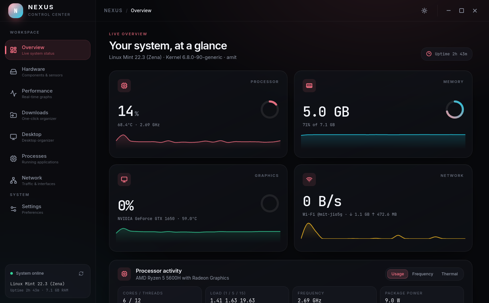
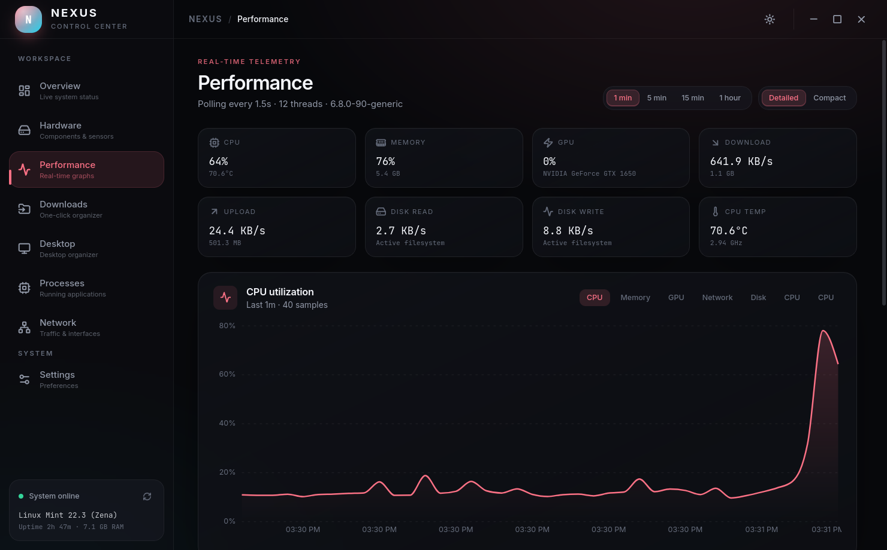
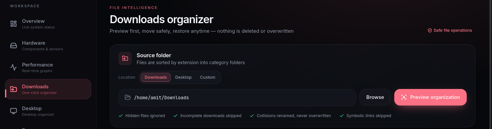
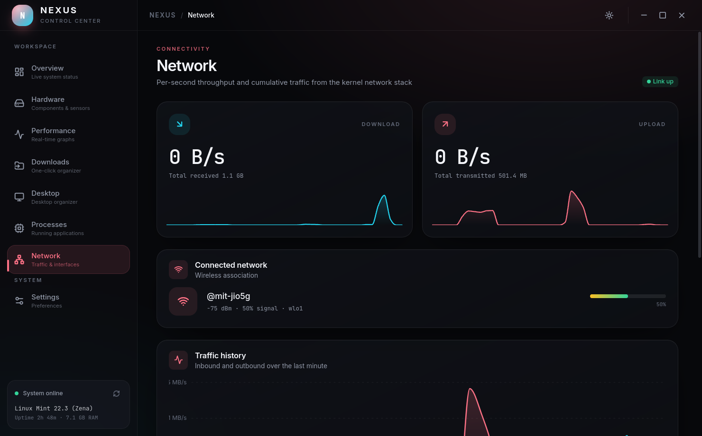
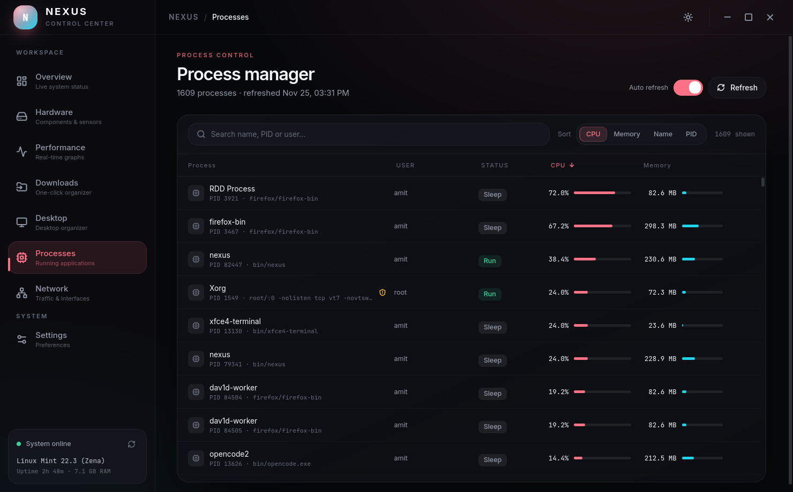
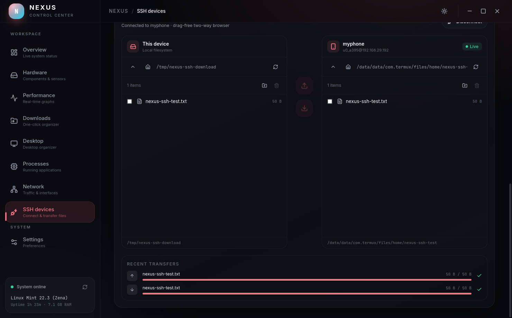
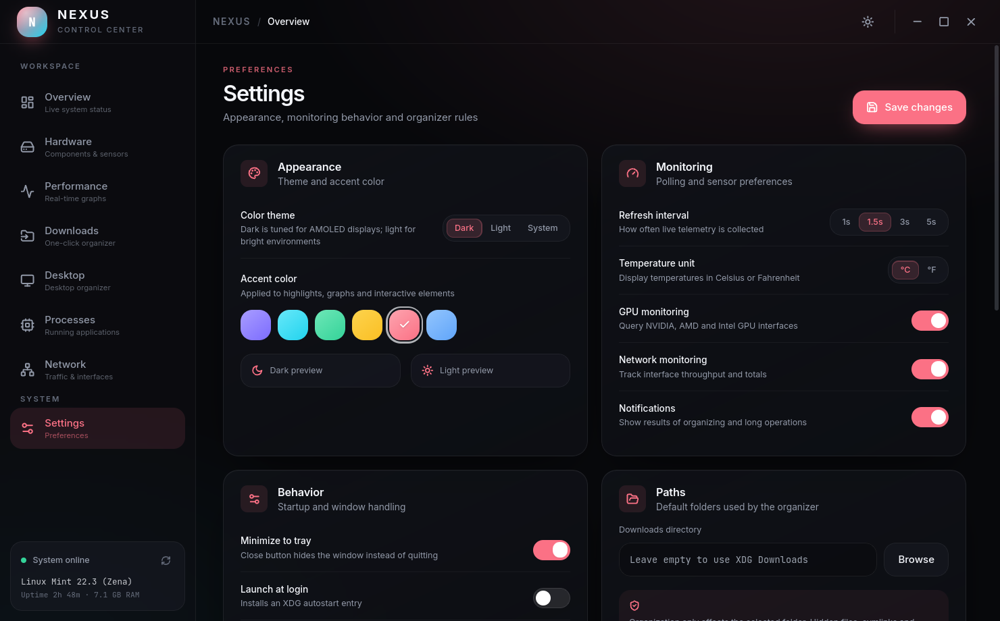

<div align="center">



# NEXUS

### The premium Linux system control center

**Live hardware monitoring · Real-time performance graphs · Safe one-click organization · SSH device manager with two-way file transfer**

[](https://www.linux.org/)
[](https://tauri.app/)
[](LICENSE)
[](https://github.com/amiitdev/nexus/releases)
[](https://github.com/amiitdev/nexus)

</div>

---

NEXUS is a lightweight, cross-distribution desktop application that brings together everything you'd normally open five different tools for:

- **What is my CPU doing right now?** — usage, per-core load, frequency, temperature, package power, load averages.
- **How much memory is really free?** — used, available, cached, buffered, swap.
- **What is my GPU doing?** — NVIDIA via `nvidia-smi`, AMD/Intel via DRM sysfs and hwmon.
- **Where is my disk going?** — capacity, filesystem, read/write throughput, NVMe temperature.
- **What is on the network?** — live up/down throughput, totals, active interface, IP and connected Wi‑Fi SSID with signal strength.
- **Can I tidy my Downloads or Desktop safely?** — preview every move, confirm, then undo or restore whenever you like.
- **Can I reach my other machines and phone?** — save SSH devices, verify host keys once, browse their folders and transfer files/folders both ways from a dual-pane file manager.

> **No invented numbers.** If your hardware or driver does not expose a reading, NEXUS shows **“Not available”** instead of a guess.

---

## Table of contents

1. [Screenshots](#screenshots)
2. [Installation](#installation) — [AppImage](#1-appimage-universal), [DEB](#2-deb-ubuntu-linux-mint-debian-pop_os), [RPM](#3-rpm-fedora-rhel-opensuse), [from source](#4-build-from-source-any-distribution), [Flatpak](#5-flatpak)
3. [First launch & quick start](#first-launch--quick-start)
4. [The Downloads / Desktop organizer](#the-downloads--desktop-organizer)
5. [SSH devices & two-way file transfer](#ssh-devices--two-way-file-transfer)
6. [Features in detail](#features-in-detail)
7. [Configuration & data paths](#configuration--data-paths)
8. [Architecture](#architecture)
9. [Performance](#performance)
10. [Troubleshooting](#troubleshooting)
11. [Uninstall](#uninstall)
12. [Contributing & license](#contributing--license)

---

## Screenshots

<details open>
<summary><b>Live overview</b> — CPU, memory, GPU, storage, network and system information in one view</summary>


</details>

<details>
<summary><b>Performance</b> — selectable 1m / 5m / 15m / 1h windows, detailed and compact modes</summary>



</details>

<details>
<summary><b>Downloads & Desktop organizer</b> — preview before anything moves</summary>



</details>

<details>
<summary><b>Network</b> — real throughput, totals, Wi‑Fi network name and signal strength</summary>



</details>

<details>
<summary><b>Process manager</b> — sortable by CPU or memory, with details and guarded termination</summary>



</details>

<details>
<summary><b>SSH devices</b> — saved devices, detected hosts, dual-pane browser and two-way transfers</summary>



</details>

<details>
<summary><b>Settings</b> — themes, six accents, polling interval, units, startup and organizer rules</summary>



</details>

---

## Installation

Pick the method for your distribution. **None of them require root for monitoring or file organization** — root is only needed to *install* a system-wide package.

### Runtime dependencies (install these if your distro does not provide them)

NEXUS uses WebKitGTK for its window, so every distro needs the WebKitGTK 4.1 runtime:

| Distribution | Runtime install command |
|---|---|
| Linux Mint / Ubuntu / Debian / Pop!_OS / elementary | `sudo apt install -y libwebkit2gtk-4.1-0 libgtk-3-0 libayatana-appindicator3-1 librsvg2-2` |
| Fedora / RHEL / CentOS Stream | `sudo dnf install -y webkit2gtk4.1 gtk3 libayatana-appindicator3 librsvg2` |
| Arch / Manjaro / EndeavourOS | `sudo pacman -S webkit2gtk gtk3 appindicator-gtk3 librsvg` |
| openSUSE | `sudo zypper install webkit2gtk4.1 gtk3 libayatana-appindicator3-1 librsvg2` |
| Solus / Void / other | Install the equivalent `webkit2gtk-4.1`, `gtk3`, `libayatana-appindicator3` and `librsvg2` packages |

Optional extras that unlock more readings:

```bash
# NVIDIA GPU metrics
sudo apt install nvidia-utils-XXX        # Ubuntu/Mint — XXX = your driver series, e.g. 550
sudo dnf install cuda-nvidia-utils       # Fedora (RPM Fusion)

# CPU / fan sensors
sudo apt install lm-sensors
sudo modprobe coretemp                   # Intel
sudo modprobe k10temp                    # AMD
```

`nvidia-smi`, `lspci`, `iw` and `lm-sensors` are used **opportunistically**: if they are missing, NEXUS degrades gracefully to “Not available”. It never fails to start because a utility is absent.

---

### 1. AppImage (universal)

Works on any glibc-based x86_64 distribution without modifying your system.

```bash
# 1. Download the latest release
cd ~/Downloads
curl -L -o NEXUS.AppImage \
  https://github.com/amiitdev/nexus/releases/latest/download/NEXUS_1.0.0_amd64.AppImage

# 2. Make it executable
chmod +x NEXUS.AppImage

# 3. Run it
./NEXUS.AppImage
```

If your distro blocks FUSE (common in containers or hardened setups):

```bash
./NEXUS.AppImage --appimage-extract-and-run
```

To make it appear in your application menu permanently:

```bash
mkdir -p ~/.local/share/applications ~/.local/share/icons
cd ~/Downloads
./NEXUS.AppImage --appimage-extract >/dev/null 2>&1
cp squashfs-root/usr/share/icons/hicolor/256x256/apps/nexus.png ~/.local/share/icons/nexus.png 2>/dev/null || true
cat > ~/.local/share/applications/nexus.desktop <<'EOF'
[Desktop Entry]
Type=Application
Name=NEXUS
GenericName=System Control Center
Comment=Live hardware monitoring and safe file organization
Exec=/home/YOUR-USER/Downloads/NEXUS.AppImage
Icon=nexus
Terminal=false
Categories=System;Utility;Monitor;
EOF
sed -i "s|YOUR-USER|$USER|" ~/.local/share/applications/nexus.desktop
update-desktop-database ~/.local/share/applications 2>/dev/null || true
```

If `update-desktop-database` is not installed, log out and back in — most desktop environments pick up new `.desktop` files automatically.

---

### 2. DEB (Ubuntu, Linux Mint, Debian, Pop!_OS, elementary)

```bash
cd ~/Downloads
curl -L -O https://github.com/amiitdev/nexus/releases/latest/download/NEXUS_1.0.0_amd64.deb

# Install (apt resolves and installs dependencies for you)
sudo apt install ./NEXUS_1.0.0_amd64.deb
```

If a dependency is missing on an older release:

```bash
sudo apt --fix-broken install
```

Launch from your application menu by searching for **NEXUS**, or run:

```bash
nexus
```

---

### 3. RPM (Fedora, RHEL, CentOS Stream, openSUSE)

```bash
cd ~/Downloads
curl -L -O https://github.com/amiitdev/nexus/releases/latest/download/NEXUS-1.0.0-1.x86_64.rpm

# Fedora / RHEL / CentOS Stream
sudo dnf install ./NEXUS-1.0.0-1.x86_64.rpm

# openSUSE (same file works)
sudo zypper install ./NEXUS-1.0.0-1.x86_64.rpm
```

Then search for **NEXUS** in your app grid or run `nexus`.

---

### 4. Build from source (any distribution)

#### Step 1 — install build tools

<details>
<summary><b>Ubuntu / Linux Mint / Debian</b></summary>

```bash
sudo apt update
sudo apt install -y build-essential curl wget file pkg-config \
  libwebkit2gtk-4.1-dev libgtk-3-dev libssl-dev \
  libayatana-appindicator3-dev librsvg2-dev libxdo-dev
```

</details>

<details>
<summary><b>Fedora / RHEL</b></summary>

```bash
sudo dnf install -y @development-tools curl wget file pkgconfig \
  webkit2gtk4.1-devel gtk3-devel openssl-devel \
  libayatana-appindicator3-devel librsvg2-devel
```

</details>

<details>
<summary><b>Arch / Manjaro / EndeavourOS</b></summary>

```bash
sudo pacman -S --needed base-devel curl wget file pkgconf \
  webkit2gtk openssl gtk3 appindicator-gtk3 librsvg
```

</details>

#### Step 2 — install Rust and Node

```bash
# Rust (minimal toolchain is enough)
curl --proto '=https' --tlsv1.2 -sSf https://sh.rustup.rs | sh -s -- -y --profile minimal
source "$HOME/.cargo/env"

# Node 20+ and pnpm
corepack enable
corepack prepare pnpm@latest --activate
node --version   # must be 20 or newer
```

#### Step 3 — clone and build

```bash
git clone https://github.com/amiitdev/nexus.git
cd nexus

pnpm install
pnpm tauri build
```

The build automatically creates all three packages:

```
src-tauri/target/release/bundle/
├── appimage/NEXUS_1.0.0_amd64.AppImage
├── deb/NEXUS_1.0.0_amd64.deb
└── rpm/NEXUS-1.0.0-1.x86_64.rpm
```

To run the development version instead:

```bash
pnpm tauri dev
```

Useful checks while developing:

```bash
pnpm build                        # TypeScript type-check + production web bundle
cd src-tauri && cargo check       # Rust type check
cd src-tauri && cargo test        # organizer safety regression tests
```

---

### 5. Flatpak

A native Flatpak build is **not shipped**. Tauri relies on WebKitGTK, which cannot currently be bundled inside the standard Flatpak SDK runtime without an out-of-band runtime package. The AppImage is the portable option and works on every major distribution listed above. If your policy requires Flatpak, wrap the AppImage with your distribution's WebKitGTK-based runtime.

---

## First launch & quick start

1. Launch **NEXUS** from your menu (or `nexus` / `./NEXUS.AppImage`).
2. The **Overview** page starts polling immediately — default interval is 1.5 seconds. Nothing needs sudo.
3. Visit **Network** to see your current Wi‑Fi network name, signal strength, live throughput and totals.
4. Visit **Downloads** or **Desktop** to tidy files:
   - Choose the location (Downloads / Desktop / Custom), then press **Preview organization**.
   - Review the exact move list and category sizes.
   - Press **Organize N files** to confirm. Nothing is deleted or overwritten.
   - Use **Undo all** or click an individual filename in **Operation history** to restore it.
5. Visit **SSH devices**. Hosts from `~/.ssh/config` appear automatically — press **Import** on one, or **Add device** for a new machine. Confirm the host fingerprint once, then browse and transfer files.
6. **Settings** lets you switch theme/accent, polling interval, temperature unit, tray behavior, launch-at-login, default Downloads folder and organizer extension rules.

**Closing the window hides it to the tray** by default (if your desktop has a system tray). Use the tray menu → **Quit NEXUS** to exit, or disable this in Settings.

---

## The Downloads / Desktop organizer

This is the feature we took most care with. The same engine powers both the **Downloads** and **Desktop** pages, and it works on any folder you type into the Custom field.

Default destination structure:

```
Downloads/
├── Documents/   PDF/ Word/ Excel/ Other/
├── Images/      PNG/ JPG/ SVG/ Other/
├── Videos/      MP4/ MKV/ AVI/ Other/
├── Audio/       MP3/ WAV/ FLAC/ Other/
├── Archives/    ZIP/ RAR/ 7Z/ TAR/
├── Applications/ DEB/ RPM/ AppImage/ Other/
├── Code/        Python/ JavaScript/ Java/ Other/
└── Other/
```

Safety rules enforced in Rust, not just in the UI:

| Rule | How it is enforced |
|---|---|
| Preview before any change | `organize` only accepts a preview ID issued by a read-only `preview` call |
| Explicit confirmation | A modal lists every source → destination and requires a button press |
| Never overwrite | Atomic Linux `renameat2(RENAME_NOREPLACE)`; collisions become `file (2).ext` |
| Never delete | Every operation is a move; no delete call exists in the organizer |
| No symlink traversal | Sources and destinations are checked with `symlink_metadata`; symlinks are skipped |
| No escaping the folder | Every destination is canonicalized and verified to remain inside the chosen directory |
| Ignore hidden / partial files | `.dotfiles`, `.part`, `.crdownload`, `.tmp`, `.!ut` and similar names are skipped by default |
| Full undo | Every move is journaled; undo an entire operation or restore a single file |
| Permission errors | Reported per file; successful moves are never destructively rolled back |

Categories, subfolders and extension lists are fully editable in **Settings → Organizer categories** (or inline on the organizer page).

---

## SSH devices & two-way file transfer

The **SSH devices** page turns NEXUS into a lightweight SFTP client for your other machines — a phone running Termux, a server, a Raspberry Pi, another laptop. It uses `libssh2` directly in Rust (compiled into the app — no system SSH client or extra runtime package needed): no `ssh`, `scp` or `rsync` subprocess, no cloud relay, and no root privileges.

### Adding a device

Three ways in, whichever is easiest:

1. **Import from `~/.ssh/config`** — NEXUS parses `Host` blocks (`HostName`, `Port`, `User`, `IdentityFile`) and shows them as *Detected SSH hosts*. Press **Import**, then **Connect**. Your existing aliases (for example a `myphone` entry) become one-click devices. When a host has no explicit `IdentityFile`, NEXUS suggests `~/.ssh/id_ed25519` (or `id_rsa`/`id_ecdsa`) automatically.
2. **Add device manually** — fill in a friendly name, host/IP, port (default `22`), username and one of:
   - **Password** — stored locally in a `0600` file.
   - **Private key** — choose a key file with **Browse**, add a passphrase if the key is encrypted.
   - **SSH agent** — uses keys already loaded with `ssh-add`; no secret is stored.
3. Edit any saved device later with the pencil button; delete removes it from NEXUS (it never touches the remote machine).

### First connection and host-key safety

On the first connection NEXUS shows the device's **SHA256 host-key fingerprint** and asks you to verify it on the device itself. Pressing **Trust & connect** stores that fingerprint and opens the session. From then on:

- A matching fingerprint connects silently.
- A **changed fingerprint blocks the connection** and shows a warning — NEXUS will not silently accept a different key (protects against man-in-the-middle attacks).
- Remove the device and re-add it only after verifying physically.

### Browsing and transferring

Once connected, a **dual-pane browser** appears:

| Pane | Contents |
|---|---|
| Left | This laptop's filesystem (via plain Rust `std::fs`) |
| Right | The remote device over SFTP |

- Click a folder to enter it; use **↑** for parent, **Home**, the path field (Enter to jump), and **Refresh**.
- Tick checkboxes to select multiple files or folders. Double-click a text file (or use the eye icon) for an inline preview.
- **Upload →** copies the selected local items into the current remote folder.
- **← Download** copies the selected remote items into the current local folder.
- Both directions are **recursive**: whole folders and their contents are transferred.
- **New folder** and **Delete** (with confirmation) work in either pane. Remote deletes are single-item / empty-folder only — no accidental recursive wipe.
- A **Recent transfers** list shows progress bars, byte counts and any per-item errors. Progress is streamed from Rust via Tauri events.

Transfers use atomic chunked reads/writes with a 128 KB buffer. Existing remote/local files are overwritten by an explicit transfer — the same surgery is *not* applied by any automatic organizer rule.

### Data locations

| Purpose | Path |
|---|---|
| Saved devices, passwords, key passphrases, trusted fingerprints | `~/.local/share/nexus/ssh-connections.json` (`0600`) |
| Live sessions | In memory only — closed when NEXUS exits or you press **Disconnect** |

> Tip: Termux on Android normally exposes files under `/storage/emulated/0` and `/data/data/com.termux/files/home`. Type that path into the remote path field to jump straight there.

---

## Features in detail

### Monitoring

| Area | What you get |
|---|---|
| CPU | Usage %, per-core utilization, temperature, current/min/max frequency, model, vendor, physical cores, logical threads, 1/5/15-minute load, package power (Intel RAPL / AMD PPT), three history graphs |
| Memory | Total, used, available, free, cached, buffers, usage %, swap used/total and a real-time graph |
| GPU | Name, vendor, utilization, temperature, VRAM used/total, clock, power and fan where exposed (NVIDIA `nvidia-smi`, AMD/Intel DRM + hwmon) |
| Storage | Capacity, used/available, filesystem, mount point, read/write speed (from `/proc/diskstats`), NVMe temperature |
| System | Distribution, version, kernel, desktop environment, hostname, architecture, uptime, motherboard and BIOS |
| Hardware center | Specification cards for CPU, RAM, GPU, motherboard, disks, battery, thermal sensors and fans |
| Performance | Eight live metric tiles, seven selectable charts, 1m/5m/15m/1h ranges, compact/detailed views |
| Processes | Name, PID, user, status, CPU, memory, executable and command line; search, clickable sortable headers, details drawer, guarded SIGTERM/SIGKILL |
| Network | Live up/down speed, cumulative totals, default interface, IPv4, link state, connected Wi‑Fi SSID and signal |
| SSH devices | Saved connections (password / key / agent), host-key TOFU verification, `~/.ssh/config` import, dual-pane SFTP browser, recursive two-way transfer, progress events |

### Design

- AMOLED-inspired dark theme plus a polished light theme and a system-following option.
- Six accent colors: violet, cyan, emerald, amber, rose and blue.
- Glass panels, subtle gradients, rounded cards, tabular numerals (Inter + JetBrains Mono), Framer Motion micro-interactions.
- Custom title bar with minimize/maximize/close, responsive layouts and lazy-loaded pages.

---

## Configuration & data paths

NEXUS follows the XDG Base Directory specification:

| Purpose | Path |
|---|---|
| Settings | `~/.config/nexus/settings.json` |
| Organizer journal | `~/.local/share/nexus/organize-history.json` |
| SSH devices & trusted host keys | `~/.local/share/nexus/ssh-connections.json` (`0600`) |
| Launch at login | `~/.config/autostart/nexus.desktop` |
| Logs | Standard output; run with `RUST_LOG=debug nexus` for verbose diagnostics |

Settings are plain JSON — safe to back up or edit by hand:

```json
{
  "theme": "dark",
  "accent": "violet",
  "refreshIntervalMs": 1500,
  "temperatureUnit": "C",
  "minimizeToTray": true,
  "launchAtLogin": false,
  "notifications": true,
  "ignoreHidden": true,
  "excludeIncomplete": true
}
```

---

## Architecture

```
src/                        React 18 + TypeScript + Tailwind CSS + Framer Motion + Recharts
├── components/layout/      App shell, custom title bar, sidebar
├── components/ui/          Design-system primitives, rings, meters, modals, charts
├── pages/                  Dashboard, Hardware, Performance, Organizer, Desktop, Processes, Network, SSH devices, Settings
├── store/                  Zustand settings + in-memory telemetry ring buffers
└── lib/                    Tauri IPC wrappers, formatting, theming

src-tauri/src/              Rust backend (Tauri 2)
├── monitor/                /proc, /sys, hwmon, DRM, DMI and nvidia-smi collectors
├── organizer.rs            Preview, atomic moves, journal, undo, restore
├── processes.rs            Process table and critical-process policy
├── ssh.rs                  SSH sessions, host-key trust, SFTP browser + transfers
├── settings.rs             XDG config + autostart
├── commands.rs             Thin #[tauri::command] layer
└── models.rs               serde contracts shared with TypeScript
```

Every displayed value comes from real Linux interfaces:

| Metric | Source |
|---|---|
| CPU usage / per-core | `sysinfo` reading `/proc/stat` with a persistent, primed sampler |
| CPU frequency | `/sys/devices/system/cpu/cpu*/cpufreq` |
| CPU load | `/proc/loadavg` |
| CPU temperature | hwmon chips `k10temp`, `coretemp`, `zenpower`, `cpu_thermal` |
| CPU power | Intel RAPL `energy_uj` or AMD `PPT` when exposed |
| Memory / swap | `sysinfo` + `/proc/meminfo` |
| GPU (NVIDIA) | `nvidia-smi` (cached for 3 s) |
| GPU (AMD / Intel) | `/sys/class/drm` + per-card hwmon |
| Disks | `sysinfo` + `/proc/diskstats` |
| Network | `/proc/net/dev` cumulative counters + `/proc/net/route` + `iw` for Wi‑Fi |
| System / BIOS | `/etc/os-release`, `/proc/sys/kernel/osrelease`, `/sys/class/dmi/id` |
| Sensors / fans | `/sys/class/hwmon` (unused 100 °C sentinel readings discarded) |
| Battery | `/sys/class/power_supply/BAT*` |

---

## Performance

- A single IPC snapshot per configurable interval; overlapping requests are skipped.
- Frontend history is a bounded ring buffer (3,600 samples ≈ 1 hour) — no growing database.
- `nvidia-smi`, `lspci` and hwmon scans are cached; no shell loops or background daemons.
- Recharts animations are disabled for live series to avoid per-frame layout cost.
- Pages are code-split with `React.lazy`; initial load only fetches the dashboard.
- Release profile: `opt-level = "s"`, LTO, stripped symbols, `panic = "abort"`. Package size ≈ 2.8 MB (DEB/RPM).

---

## Troubleshooting

| Symptom | Cause / fix |
|---|---|
| “Could not find WebKitGTK” on launch | Install the runtime package from the table above. On very old distros, use the AppImage with `--appimage-extract-and-run`. |
| AppImage will not start (FUSE error) | `./NEXUS.AppImage --appimage-extract-and-run`, or install `fuse2`/`libfuse2`. |
| CPU / per-core shows `0%` briefly | First sample needs a prior counter reading; the second poll (≈1.5 s later) shows real values. |
| GPU utilization or power is “Not available” | Your driver does not expose it. AMD mobile GPUs commonly expose temperature but not utilization. Install `nvidia-utils` for NVIDIA metrics. |
| No temperatures / fans | Load sensor modules (`coretemp`, `k10temp`) or install `lm-sensors`. hwmon inputs reporting the 100 °C sentinel are intentionally hidden. |
| No Wi‑Fi name shown | Requires `iw` (or `iwgetid`). Wired connections show the interface and IP instead. |
| Not in the application menu | Log out/in, or create the `.desktop` file shown in the AppImage section. |
| Tray icon missing | Install `libayatana-appindicator3-1`; disable “Minimize to tray” in Settings if your desktop has no tray. |
| Organizer skipped a file | Hidden, partial, symlinked or already-organized files are skipped by design — the reason is shown in the preview. |
| SSH connection times out | Check the device is on the same network, the IP and port are correct, and port 22/8022 is open. For Termux, `sshd` must be running (`sshd` in Termux). |
| SSH says “Authentication failed” | Verify username/password, or for key auth check the key path and passphrase. With `agent`, confirm `ssh-add -l` lists the key. |
| SSH fingerprint warning appears | The remote host key changed. Verify on the device; never blindly re-trust. |
| No hosts detected from SSH config | NEXUS reads `~/.ssh/config`. Wildcard `Host *` blocks are ignored; add an explicit `Host` alias. |
| Transfer stops with a permission error | The SSH user lacks write permission in that remote folder; pick a writable folder or use `~/`. |
| Verbose diagnostics | `RUST_LOG=debug nexus` |

---

## Uninstall

```bash
# DEB
sudo apt remove nexus

# RPM — Fedora / RHEL
sudo dnf remove nexus

# RPM — openSUSE
sudo zypper remove nexus

# AppImage
rm -f ~/Downloads/NEXUS.AppImage ~/.local/share/applications/nexus.desktop

# Optional: remove user configuration and history
rm -rf ~/.config/nexus ~/.local/share/nexus ~/.config/autostart/nexus.desktop
# This also removes saved SSH devices and trusted fingerprints.
```

---

## Contributing & license

Issues and pull requests are welcome at <https://github.com/amiitdev/nexus>. Please run `pnpm build`, `cargo check` and `cargo test` before opening a PR, and never add synthetic hardware readings — missing data must stay “Not available”.

Released under the [MIT License](LICENSE). Built and tested on Linux Mint 22.3, with support for Ubuntu, Debian, Fedora, Arch and other mainstream distributions.

<div align="center">

**Made for people who want a beautiful, honest and safe control center for their Linux machine.**

⭐ Star the repo if **NEXUS** helped you.

</div>
